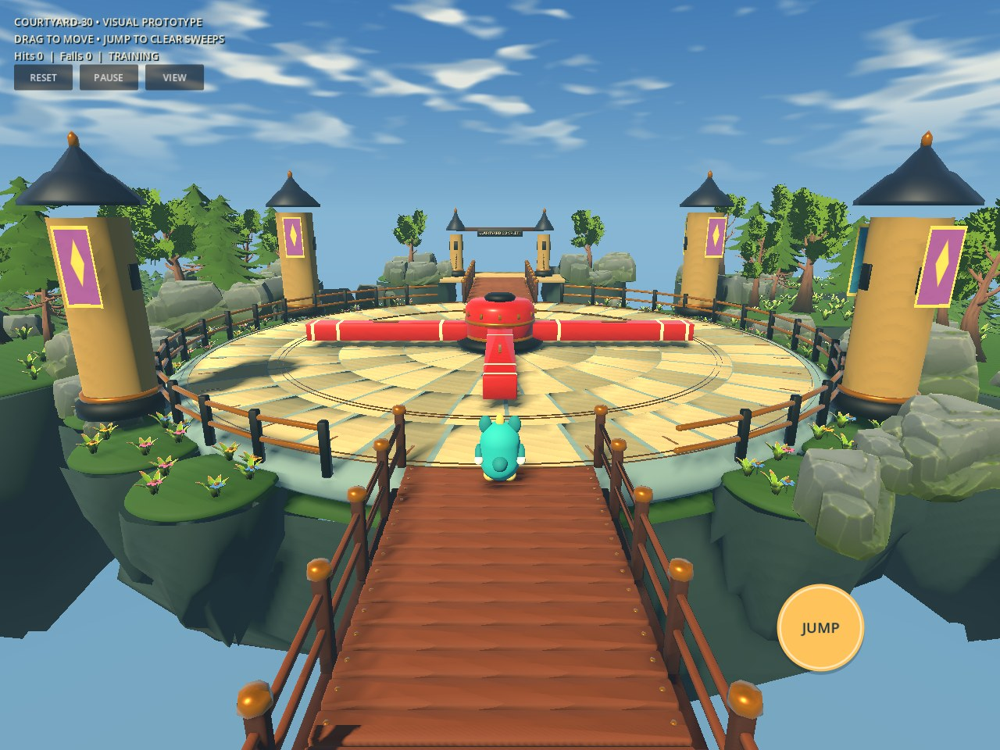

## Standalone Training Courtyard — COURTYARD-30

**[Download the isolated prototype](https://raw.githubusercontent.com/evaristestiven/Almost-made-it/main/downloads/Almost-Made-It-COURTYARD-30.zip)** · [Final report](downloads/COURTYARD30_REPORT.txt) · [Validation](downloads/COURTYARD30_VALIDATION.json)

This separate project opens directly into the Training Courtyard. The existing campaign and playable Level1 remain unchanged. Unzip into a new folder, open project.godot in Xogot and let imports regenerate. Use VIEW to cycle inspection cameras; the ordinary swipe-and-drag and JUMP controls remain.

Five inspected views: [Overview](downloads/courtyard30-gallery/01-overview.jpg) · [Entrance](downloads/courtyard30-gallery/02-entrance.jpg) · [Mechanism](downloads/courtyard30-gallery/03-central-mechanism.jpg) · [Exit](downloads/courtyard30-gallery/04-exit.jpg) · [Gameplay](downloads/courtyard30-gallery/05-gameplay.jpg).

Prototype acceptance passed30 checks at each30/60/120Hz; remote clean import,30 checks and five GL captures also passed. Slow/fast stationary hits physically moved the avatar0.39m/1.93m. All1595 pre-existing source files are unchanged. Architecture is bespoke modular geometry with existing imported Quaternius vegetation. It remains simpler than the reference; iPhone/iPad performance and final art approval remain unverified.

---

# Almost Made It! — FOREST-29

## Latest complete Godot/Xogot project

**[Download FOREST-29.zip](https://raw.githubusercontent.com/evaristestiven/Almost-made-it/main/downloads/Almost-Made-It-FOREST-29.zip)**

[Alternative GitHub file page](https://github.com/evaristestiven/Almost-made-it/blob/main/downloads/Almost-Made-It-FOREST-29.zip) — use Download raw file.

Download the named ZIP directly. GitHub's automatic Source code archive contains the download files, rather than the extracted game.

### New verified tree integration

CommonTree_5 now replaces 154 existing broadleaf forest positions in Level 1. Its original geometry, bark/normal maps and leaf atlas are intact. Existing CommonTree_3/4 and Pine_1/5 remain. Total forest count, terrain-supported roots, heights and gameplay collisions are unchanged. Regional MultiMesh batching and distance culling are reused.

TwistedTree_1–5 geometry is available, but these models remain excluded until Bark_TwistedTree.png, Bark_TwistedTree_Normal.png and Leaves_TwistedTree_C.png are supplied. No placeholder trees were substituted.

### Existing gameplay retained

Three raised stepping-stone links, two optional coin gardens, alternating courtyard approaches and two rising gorge ferries remain. Manual swipe-and-drag, jump, avatar, camera, solid collisions, knockback, checkpoints and finish/replay logic are preserved. Levels 2–10 remain unchanged.

### Open in Xogot

1. Download FOREST-29.zip in Safari and unzip into a new folder in Files.
2. Open `AlmostMadeIt-FOREST-29/project.godot` in Xogot and let imports regenerate.
3. Confirm title **Almost Made It! FOREST-29**, then run First Steps.
4. Inspect the mixed forests in Starting Garden and Windmill Hills; test drag/jump, hazards, checkpoint recovery and replay.
5. For an isolated comparison, run `scenes/visual_tests/broadleaf_test.tscn`.

Keep the previous project and saves as backup. A new title/folder may use separate local save storage.

### Executed validation

Five source suites: 470 assertions passed. Three fresh-package suites: 424 assertions passed. Four GL Compatibility views captured and inspected. Source and clean-package imports passed. Full scripted 60Hz Level1 traversal: 165.08 simulated seconds, zero falls, five coins, exactly one victory; restart included 15 seconds idle. A/B visual and collision snapshots passed for Levels 2–10.

These are scripted simulation results, not human completion times or mobile FPS measurements. Xogot/iPhone/iPad performance and touch feel remain unverified. Existing terrain faceting, sky banding and simpler buildings remain; this is a controlled tree integration rather than a complete scenery rebuild.

[FOREST-29 report](downloads/FOREST29_REPORT.txt) · [Checksum](downloads/Almost-Made-It-FOREST-29.sha256)

### Earlier builds

[FOREST-28](downloads/Almost-Made-It-FOREST-28.zip) · [ADVENTURE-27](downloads/Almost-Made-It-ADVENTURE-27.zip) · [WORLD-25](downloads/Almost-Made-It-WORLD-25.zip)
